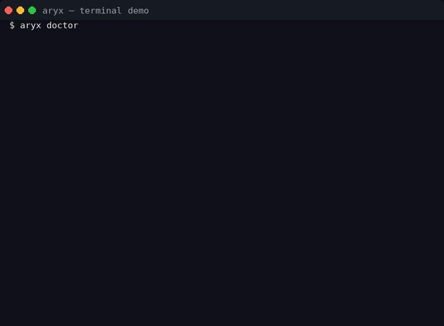
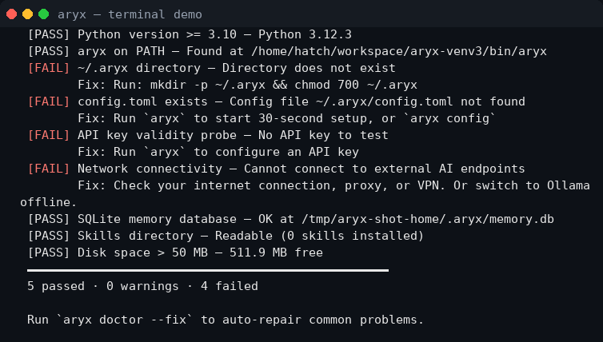
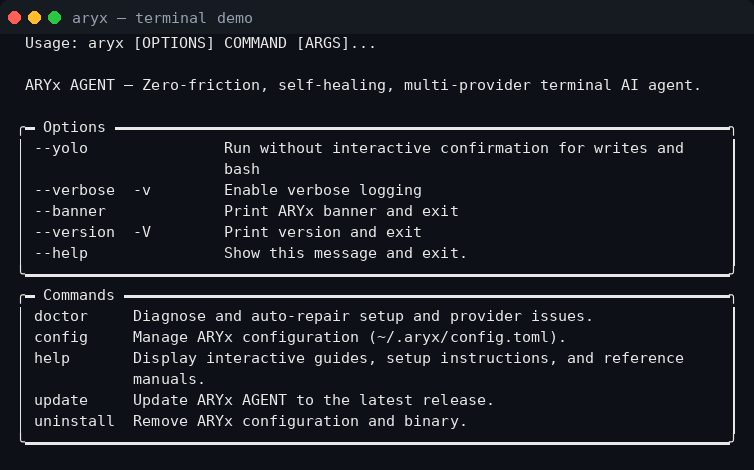
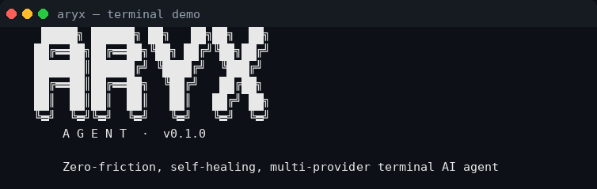
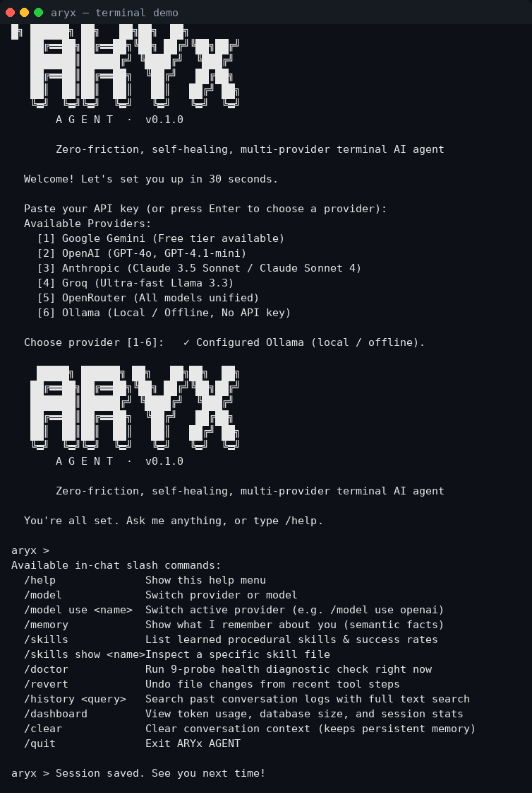

# ARYx AGENT

**Your terminal AI agent. One command to install. Any API key. Chat in 30 seconds.**

ARYx works with Gemini, OpenAI, Anthropic, Groq, OpenRouter, and Ollama — running commands, editing files, searching the web, and remembering your work. If anything breaks, `aryx doctor` diagnoses and fixes it. And the same agent can be controlled from Telegram, WhatsApp, Discord, Slack, or a browser.

## See it working

Real run of this build — `aryx doctor`, `aryx --help`, `aryx --banner`, and the 30-second first-run setup (the Ollama path needs no API key):



| `aryx doctor` | `aryx --help` |
|---|---|
|  |  |

| `aryx --banner` | First-run setup |
|---|---|
|  |  |

Note: the doctor screenshot was taken in a sandbox without external network access, so the network check fails there — on a normal machine it passes. Each failure carries its exact fix, which is the point of `aryx doctor`.

## Use it in 30 seconds

```bash
git clone https://github.com/fsix7115-arch/ARYX-agent
cd ARYX-agent/aryx-agent
./install.sh
aryx
```

Paste your API key when asked. That's it — ARYx auto-detects the provider from the key prefix, validates it with a tiny probe, and drops you straight into the chat. No key? Pick Ollama (local, free) during setup.

## Control it from anywhere

The same agent brain answers on Telegram, WhatsApp, Discord, Slack, or a browser Web UI — with memory and skills shared across channels. Start a task on Telegram, continue it on the terminal.

```bash
aryx gateway setup        # interactive wizard (<5 min per channel)
aryx gateway start        # start all enabled channels
aryx gateway link         # 10-minute code, then /link CODE on your channel
```

Security default is deny: only allow-listed users get replies, and messaging channels are forced into safe approval mode with native Approve/Reject buttons. Full guide: [`aryx-agent/docs/GATEWAY.md`](aryx-agent/docs/GATEWAY.md).

## What it can do

- **Any provider** — Gemini, OpenAI, Anthropic, Groq, OpenRouter, Mistral, Together, or local Ollama.
- **Real tools** — read/write files, sandboxed bash and Python, web search and fetch, with safety snapshots (undo with `/revert`).
- **Sticky memory** — SQLite memory with conversation history, full-text search, and learned facts.
- **Self-improving** — complex tasks automatically become reusable skills.
- **Self-healing** — `aryx doctor` runs 15 checks (9 core + 6 gateway) and `--fix` repairs common problems.

## Full docs

- [`aryx-agent/README.md`](aryx-agent/README.md) — complete guide: providers, tools, in-chat commands.
- [`aryx-agent/docs/SETUP.md`](aryx-agent/docs/SETUP.md) — step-by-step setup.
- [`aryx-agent/docs/PROVIDERS.md`](aryx-agent/docs/PROVIDERS.md) — providers and models.
- [`aryx-agent/docs/GATEWAY.md`](aryx-agent/docs/GATEWAY.md) — Telegram, WhatsApp, Discord, Slack, Web UI.
- [`aryx-agent/docs/SKILLS.md`](aryx-agent/docs/SKILLS.md) — the self-improving skill system.
- [`aryx-agent/docs/FAQ.md`](aryx-agent/docs/FAQ.md) — frequently asked questions.

## Layout

- `aryx-agent/` — the Python project: installer, source, tests, and docs.
- The remaining files at this repo root are a separate experimental web console and are not needed to run the terminal agent.


## License

MIT — see [LICENSE](LICENSE). Free to use, modify, and share.
